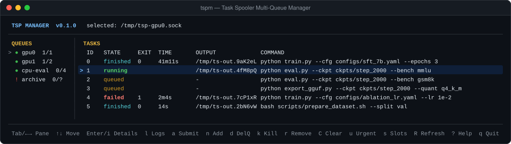

<p align="right">
  <strong>English</strong> | <a href="./README_zh-CN.md">简体中文</a>
</p>

# TSP Manager (`tspm`)

[](https://github.com/Clamours/tspm/releases)
[](https://go.dev/)
[](#requirements)
[](./LICENSE)

A lightweight multi-queue TUI and CLI manager for [Task Spooler](https://viric.name/soft/ts/) (`tsp`) on Linux.

Instead of juggling `TS_SOCKET=... tsp ...` across terminals, manage all your Task Spooler queues from one dashboard. `tspm` does not replace `tsp` or run a daemon — every operation delegates directly to the native `tsp` CLI.



## Features

- **Multi-queue TUI**: Monitor queues (running/pending/finished/slots) and tasks side by side.
- **Safe auto-discovery**: Finds active listening `tsp` Unix sockets owned by you via `/proc/net/unix`, with manual registration for custom paths.
- **Task inspection & live logs**: View `tsp -i` details and tail output files asynchronously (supports `tsp -g` gzip logs and `\r` progress bars).
- **Full job control**: Submit, kill (`SIGTERM`), remove, clear finished, reprioritize, and change concurrency slots.
- **Scriptable CLI**: Table view (`tspm queues`) and JSON output (`tspm status`) for shell scripts and agents.
- **Zero-dependency binary**: Static Go build (`CGO_ENABLED=0`), no root required.

## Requirements

- **Linux** (`amd64` / `arm64`) with an ANSI-capable terminal.
- **[Task Spooler](https://viric.name/soft/ts/)** installed (`sudo apt install task-spooler` on Debian/Ubuntu). If your binary is named `ts`, use `--tsp-bin ts` or set `"tsp_bin": "ts"` in config.

## Installation

**Prebuilt binary** (download from [GitHub Releases](https://github.com/Clamours/tspm/releases)):

```bash
tar -xzf tspm-linux-amd64.tar.gz && cd tspm-linux-amd64
./install.sh   # installs to ~/.local/bin without sudo
```

**Via `go install`** (Go 1.24+):

```bash
go install github.com/Clamours/tspm/cmd/tspm@latest
```

**From source**:

```bash
git clone https://github.com/Clamours/tspm.git && cd tspm
make build && install -m 755 ./tspm ~/.local/bin/tspm
```

## Quick Start

```bash
tsp sleep 60                                  # ensure at least one tsp queue exists
tspm                                          # launch interactive TUI
tspm queue add gpu0 /tmp/my-gpu0-queue.sock   # register a custom TS_SOCKET path
```

## TUI Keybindings

| Key | Action |
|---|---|
| `↑` / `↓` | Move selection |
| `Tab` / `←` / `→` / `g` / `t` | Switch Queues / Tasks pane (`→` in Tasks opens details) |
| `Enter` / `i` | Open Tasks pane or view task details (`tsp -i`) |
| `l` | Tail live task output |
| `a` | Submit shell command (`sh -c`) to current queue |
| `n` / `d` | Register / unregister queue (never stops the `tsp` server) |
| `k` / `r` / `C` | Kill (`tsp -k`) / Remove (`tsp -r`) / Clear finished (`tsp -C`) |
| `u` / `s` | Prioritize task (`tsp -u`) / Set concurrency slots (`tsp -S`) |
| `R` / `?` | Refresh all queues / Toggle help |
| `q` / `Esc` / `Ctrl-C` | Quit (`Ctrl-C` exits from any screen) |

> Overlays (Logs / Details / Help) support `↑`/`↓`/`j`/`k`, `PgUp`/`PgDn`, `g`/`G`/`Home`/`End`, and `Esc`/`←`/`q` to close. Prompts support `Backspace`, `Ctrl-W`, `Ctrl-U`, and `Esc`.

## CLI

```bash
tspm queues                                   # list queues
tspm status                                   # JSON output (--json is equivalent)
tspm doctor                                   # check tsp binary & sockets
tspm queue add gpu0 /tmp/tsp-gpu0.sock        # register queue
tspm queue remove gpu0                        # unregister queue only
tspm submit -q gpu0 -- python train.py        # submit command
tspm --config /path/cfg.json --tsp-bin ts queues
```

> Multiple arguments to `tspm submit` are individually shell-quoted; pass pipelines or compound shell commands as a single quoted argument (e.g. `tspm submit -q gpu0 -- 'python train.py | tee train.log'`).

## Configuration

Stored at `~/.config/tspm/config.json` (override with `TSPM_CONFIG` or `--config`). Run `tspm config init` to generate defaults, or see [examples/config.json](./examples/config.json):

```json
{
  "tsp_bin": "tsp",
  "refresh_interval_seconds": 2,
  "auto_discover": true,
  "queues": [
    { "name": "gpu0", "socket": "/tmp/tsp-gpu0.sock" }
  ]
}
```

## Notes & Limitations

- **Safe discovery**: Scans `/proc/net/unix` for your active listening sockets matching common `tsp` names (`socket-ts.*`, `tsp-*`, `tsp_*`, `ts-*`, `ts_*`, `task-spooler`), plus `$TS_SOCKET` and `$TMPDIR/socket-ts.<uid>`. Never probes arbitrary sockets to avoid accidentally spawning `tsp` servers.
- **Registered queues** always appear in the list even when offline. Use `tspm queue add` for non-standard socket names.
- **No `tsp -K` action**: Intentionally omitted to avoid killing an entire queue server by mistake.
- **Parser compatibility**: Targets standard Task Spooler 1.0.x output. If your fork differs, please open an [issue](https://github.com/Clamours/tspm/issues) with a sanitized `tsp -l` sample and `tspm doctor` output.

## Development

```bash
go test -race ./...
make build        # or: make linux-amd64 / make linux-arm64
```

## License

MIT — see [LICENSE](./LICENSE).
