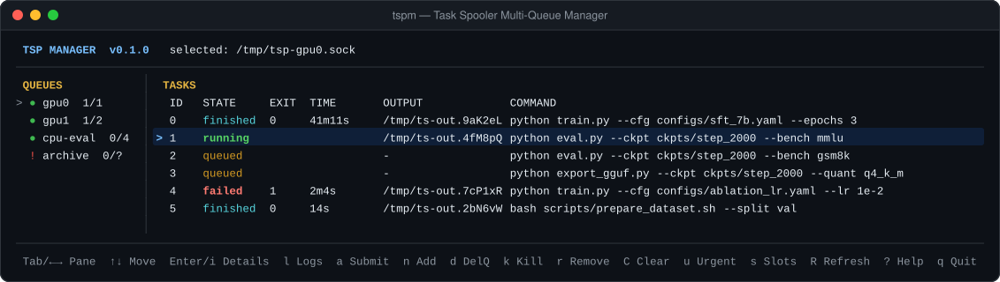

<p align="right">
  <a href="./README.md">English</a> | <strong>简体中文</strong>
</p>

# TSP Manager (`tspm`)

[](https://github.com/Clamours/tspm/releases)
[](https://go.dev/)
[](#系统要求)
[](./LICENSE)

一个面向 Linux 的 [Task Spooler](https://viric.name/soft/ts/)（`tsp`）轻量级多队列 TUI 与 CLI 管理器。

无需在终端里反复切换 `TS_SOCKET=... tsp ...`，在一个界面中即可统一查看和管理所有队列。`tspm` 不替代 `tsp`，也不运行常驻 daemon，所有操作均直接调用原生 `tsp` CLI 完成。



## 特性

- **多队列 TUI**：同屏查看各队列状态（运行/等待/完成/并发 slots）与任务列表。
- **安全自动发现**：通过 `/proc/net/unix` 自动发现当前用户的活跃 `tsp` socket，同时支持手动登记任意路径。
- **详情与实时日志**：查看 `tsp -i` 信息，后台异步 tail 输出文件（兼容 `tsp -g` gzip 日志与 `\r` 进度条）。
- **日常任务控制**：提交任务、发送 `SIGTERM`、移除、清理已完成任务、提升优先级、调整并发数。
- **脚本与 Agent 友好**：提供表格视图（`tspm queues`）与 JSON 输出（`tspm status`）。
- **单文件静态二进制**：Go 静态编译（`CGO_ENABLED=0`），无需 root 权限。

## 系统要求

- **Linux**（`amd64` / `arm64`）及支持 ANSI 转义序列的终端。
- 已安装 **[Task Spooler](https://viric.name/soft/ts/)**（Debian/Ubuntu 可执行 `sudo apt install task-spooler`）。若命令名为 `ts`，可通过 `--tsp-bin ts` 或配置 `"tsp_bin": "ts"` 指定。

## 安装

**预编译二进制**（前往 [GitHub Releases](https://github.com/Clamours/tspm/releases) 下载）：

```bash
tar -xzf tspm-linux-amd64.tar.gz && cd tspm-linux-amd64
./install.sh   # 安装到 ~/.local/bin，无需 sudo
```

**通过 `go install`**（需要 Go 1.24+）：

```bash
go install github.com/Clamours/tspm/cmd/tspm@latest
```

**从源码编译**：

```bash
git clone https://github.com/Clamours/tspm.git && cd tspm
make build && install -m 755 ./tspm ~/.local/bin/tspm
```

## 快速开始

```bash
tsp sleep 60                                  # 确保至少有一个活跃 tsp 队列
tspm                                          # 启动交互式 TUI
tspm queue add gpu0 /tmp/my-gpu0-queue.sock   # 手动登记自定义 TS_SOCKET 路径
```

## TUI 快捷键

| 按键 | 操作 |
|---|---|
| `↑` / `↓` | 移动选择 |
| `Tab` / `←` / `→` / `g` / `t` | 切换队列/任务窗格（任务窗格按 `→` 打开详情） |
| `Enter` / `i` | 进入任务列表或查看任务详情（`tsp -i`） |
| `l` | 实时查看任务输出尾部 |
| `a` | 向当前队列提交 Shell 命令（`sh -c`） |
| `n` / `d` | 登记 / 取消登记队列（不会停止 `tsp` server） |
| `k` / `r` / `C` | 发送 SIGTERM（`tsp -k`）/ 移除（`tsp -r`）/ 清理已完成（`tsp -C`） |
| `u` / `s` | 提前任务（`tsp -u`）/ 修改并发 slots（`tsp -S`） |
| `R` / `?` | 立即刷新 / 查看帮助 |
| `q` / `Esc` / `Ctrl-C` | 退出（`Ctrl-C` 在任意界面均可直接退出） |

> 日志/详情/帮助视图支持 `↑`/`↓`/`j`/`k`、`PgUp`/`PgDn`、`g`/`G`/`Home`/`End` 滚动及 `Esc`/`←`/`q` 关闭；输入弹窗支持 `Backspace`、`Ctrl-W`、`Ctrl-U`、`Esc`。

## CLI 用法

```bash
tspm queues                                   # 列出队列
tspm status                                   # 输出 JSON 状态（与 --json 等价）
tspm doctor                                   # 检查 tsp 二进制与 socket 状态
tspm queue add gpu0 /tmp/tsp-gpu0.sock        # 登记队列
tspm queue remove gpu0                        # 仅取消登记，不停止队列
tspm submit -q gpu0 -- python train.py        # 提交任务
tspm --config /path/cfg.json --tsp-bin ts queues
```

> `tspm submit` 会对多个参数分别进行 shell-quote；包含管道或重定向的复合命令请作为单个字符串传入（如 `tspm submit -q gpu0 -- 'python train.py | tee train.log'`）。

## 配置

默认配置文件路径为 `~/.config/tspm/config.json`（可通过 `TSPM_CONFIG` 或 `--config` 覆盖）。运行 `tspm config init` 可生成默认配置，示例见 [examples/config.json](./examples/config.json)：

```json
{
  "tsp_bin": "tsp",
  "refresh_interval_seconds": 2,
  "auto_discover": true,
  "queues": [
    { "name": "gpu0", "socket": "/tmp/tsp-gpu0.sock" }
  ]
}
```

## 机制与限制

- **安全自动发现**：仅扫描 `/proc/net/unix` 中属于当前用户、处于监听状态且符合常见 `tsp` 命名规则（`socket-ts.*`、`tsp-*`、`tsp_*`、`ts-*`、`ts_*`、`task-spooler`）的 socket，以及 `$TS_SOCKET` 与 `$TMPDIR/socket-ts.<uid>`；不会盲目探测未知 socket，避免意外启动 server。
- **已登记队列** 即使离线也会显示；非标准命名路径请使用 `tspm queue add` 手动登记。
- **不提供 `tsp -K`**：刻意省略，避免误操作停止整个队列 server。
- **格式兼容**：适配常见 Task Spooler 1.0.x 输出；若遇到不同 fork 的解析问题，欢迎附脱敏后的 `tsp -l` 样例和 `tspm doctor` 输出提交 [Issue](https://github.com/Clamours/tspm/issues)。

## 开发与测试

```bash
go test -race ./...
make build        # 或 make linux-amd64 / make linux-arm64
```

## License

MIT — 详见 [LICENSE](./LICENSE)。
